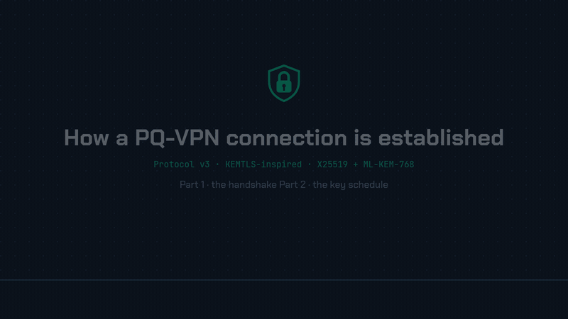

# PQ-VPN

A hybrid classical + post-quantum research VPN for Linux. Each session combines X25519 with ML-KEM-768, so breaking one of the two primitives does not break the session.

**This is a research prototype.** The protocol is KEMTLS-inspired, not standardized KEMTLS. It has a Tamarin model but no independent cryptographic review, and it makes no claim of production-grade security.

---

## Overview

PQ-VPN runs a custom handshake over TCP, then carries IP packets over UDP from a Linux TUN device. Traffic is encrypted with AES-256-GCM, using directional keys derived with HKDF-SHA256.

There are two implementations of the same protocol and wire format. Each half can be switched on its own:

- **Python** (the default): `handshake/kemtls.py` and `vpn/runtime.py`, with ML-KEM from liboqs.
- **Rust core** (`core/`): the `pqvpn_core` extension provides the data plane and the handshake, and `pqvpnd` is a native client. Both use aws-lc-rs for every primitive. Turn it on with `data_plane = "rust"` and `handshake = "rust"`, or with `client_backend = "native"` (see [Rust core](#rust-core)).

Shared test vectors keep both implementations byte-identical. Because the wire format is unchanged, the Tamarin model covers both.

### How a connection is established

<p align="center">
  
</p>

The animation shows the **protocol v3** handshake at 1.5× speed: four messages, 4,792 bytes and two round trips, then AES-256-GCM over UDP. Managed desktop clients speak **protocol v2**. It has the same hybrid key exchange, but the client authenticates with Ed25519 (see [Cryptography](#cryptography)).

---

## Features

- **Hybrid handshake:** ephemeral X25519 plus ML-KEM-768. The server's static ML-KEM-768 identity is pinned by its SHA-256 fingerprint.
- **Protocol versions:**
  - v2: Ed25519 client authentication.
  - v3: fully post-quantum mutual authentication with ML-KEM.
  - v3-mldsa: an ML-DSA-44 comparison suite, Python only.
- **1-RTT session resumption**, with fresh X25519 and ML-KEM material on every resume.
- **Post-compromise recovery:** the v3 hybrid re-handshake recovers from a passive adversary after full state compromise, and from an active adversary who has only the control keys.
- **DoS resistance:** an optional stateless cookie challenge before any KEM work.
- **Rust core:**
  - Data plane: `recvmmsg`/`sendmmsg` plus UDP GSO/GRO.
  - Rust handshake.
  - `pqvpnd`, a native client.
  - `unsafe` code lives in one small crate, `pqvpn_fd`.
- **Kill switch** (opt-in): an nftables table that blocks all traffic outside the tunnel and stays in place if the client crashes (it fails closed).
- **Leak prevention:**
  - IPv6 is blocked in full-tunnel mode.
  - Connect fails closed without systemd-resolved.
  - A full tunnel with managed DNS but no DNS servers is refused.
- **Desktop GUI:** a PySide6 app with a managed device identity, up to five server profiles, and self-service or offline enrollment.
- **Account system:** an HTTPS API with:
  - invite-only registration and optional TOTP,
  - device binding, either auto-approved or admin-approved,
  - sign-out that suspends the device.
- **Privilege separation:** the unprivileged GUI talks to a CAP_NET_ADMIN service over a Unix socket. The service accepts only root and the uids in `PQVPN_ALLOWED_UIDS`.
- **Formal model:** Tamarin Prover checks 13 lemmas across two theories: secrecy, forward secrecy, mutual authentication, KCI resistance and PCS.
- **Pentested:** a 70-attack checklist was run against the code and a live test server ([pentesting/](pentesting/)).

---

## Cryptography

| Role | Algorithm |
|---|---|
| Server authentication | Static ML-KEM-768 (pinned SHA-256 fingerprint) |
| Session establishment | X25519 + ephemeral ML-KEM-768 |
| Client authentication | Ed25519 (v2), ML-KEM-768 (v3) or ML-DSA-44 (v3-mldsa) |
| Traffic encryption | AES-256-GCM (directional keys) |
| Key derivation | HKDF-SHA256 |

| Primitive provider | Python path | Rust path |
|---|---|---|
| ML-KEM-768 | liboqs 0.16.0 | aws-lc-rs 1.18.2 |
| X25519, Ed25519, AES-GCM, HKDF | `cryptography` | aws-lc-rs |

> **Notes**
> - v2 client authentication uses classical Ed25519, so it is not post-quantum. v3 replaces it with ML-KEM-768.
> - A server that serves desktop users must keep `protocol_version = 2`, the code default. A v3 server rejects v2 clients with "Unsupported version". The example files in `config/` set 3 for TOML-mode testing.
> - The Rust build seeds aws-lc's random generator from `getrandom` rather than CPU jitter entropy. See [design.md](docs/design.md#randomness-in-the-rust-build) for that trade-off.

---

## Architecture

```
┌──────────────────┐
│  PySide6 GUI     │  normal user
│  (pqvpn-gui)     │
└────────┬─────────┘
         │ Unix socket IPC (SO_PEERCRED)
┌────────▼─────────┐
│  Client service  │  CAP_NET_ADMIN
│  app/client.py   │
│   ├ VPNClient    │  client_backend = "python" (default)
│   └ pqvpnd       │  client_backend = "native": supervised child,
│     --status-json│  status as JSON lines
│  TUN, routes,    │
│  DNS, IPv6 guard,│
│  kill switch     │
└────────┬─────────┘
         │ TCP control + UDP data
┌────────▼─────────┐
│  VPNServer       │  pqvpn user + CAP_NET_ADMIN
│  vpn/runtime.py  │  authz, IP pool, cookies, limiter, revocation in Python;
│                  │  data plane / handshake in Python or pqvpn_core
│  TUN, NAT, nft   │
└──────────────────┘
```

There is no Rust server binary. The server is always the Python `VPNServer`, which can load `pqvpn_core` for its data plane and handshake.

---

## Requirements

| | Client (desktop) | Server |
|---|---|---|
| OS | Linux (Arch or Debian/Ubuntu for the installer); not Windows or macOS | Linux (Ubuntu for `deploy-server.sh`) |
| Python | 3.11+ (tested on 3.14) | 3.11+ (tested on 3.14) |
| Native | liboqs 0.16.0, built by `scripts/install-liboqs.sh` | same |
| Rust (only for the Rust core) | stable Rust, MSRV 1.85 (`core/rust-toolchain.toml` pins 1.99.1), cargo, maturin | same, root toolchain for `deploy-server.sh` |
| Build tools | git, CMake, Ninja, gcc/g++, OpenSSL headers, rsync | same |
| Network tools | iproute2, nftables | iproute2, nftables |
| DNS | `systemd-resolved`; Connect fails closed without it unless `dns_mode = "none"`, which lets DNS bypass the VPN | n/a |
| Kernel | TUN device (`/dev/net/tun`) | TUN device |
| Privileges | `sudo` once, for install; the service then runs with `CAP_NET_ADMIN` only | root for install |
| Network | outbound TCP 8443 (account API) and TCP/UDP 51820 (tunnel) | inbound 8443 and 51820 |
| Account | an **invite code** from the server admin | n/a |

The GUI needs a graphical session (Wayland or X11).

---

## Quick start

### Install the desktop client (script)

```bash
git clone git@github.com:gopinath2704/Hybrid-Classical-and-Post-Quantum-VPN-.git
cd Hybrid-Classical-and-Post-Quantum-VPN-
sudo bash scripts/install-client.sh
```

What the script does:

- installs the system packages and builds liboqs;
- copies the app to `/opt/pqvpn`, with its own venv;
- starts the privileged `pqvpn-client` service, and authorizes only the user who ran `sudo` (through `PQVPN_ALLOWED_UIDS` in a systemd drop-in).

It installs the Python implementation only, with no `pqvpnd`. Re-running it upgrades the install and keeps the device identity and state in `/var/lib/pqvpn`.

Then launch **PQ-VPN** from the app menu (or run `pqvpn-gui`), register with your invite code, and press Connect. `systemctl status pqvpn-client` shows the service.

**Updating:** run `git pull && sudo bash scripts/install-client.sh`.

- The restart drops an active tunnel.
- The identity and profile are kept, so you don't register again.
- Reopen the GUI and sign in again, because the session token lives only in GUI memory.

### Distribution packages

Use **either** the script **or** a package, not both: they install separate copies and separate `pqvpn-client` units. The packages also build and install the Rust core: the `pqvpn_core` extension and `/usr/bin/pqvpnd`. Neither bundles liboqs, so install it first:

1. `sudo bash scripts/install-liboqs.sh /usr/local`
2. Install `liboqs-python==0.16.0` where the system `python3` can import it. The packaged service runs `/usr/bin/python3 -s`.

- **Arch:**
  1. Run `cd packaging/arch && makepkg -fC --nodeps`, then `sudo pacman -U pqvpn-3.0.0-1-x86_64.pkg.tar.zst`. Keep the `-C`: without it, makepkg can reuse a stale `src/` build.
  2. Before the first install, create `/etc/systemd/system/pqvpn-client.service.d/allowed-uids.conf` containing `[Service]` and `Environment=PQVPN_ALLOWED_UIDS=<your uid>`, or the GUI is refused.
- **Debian / Ubuntu:** build `pqvpn_3.0.0-1_amd64.deb` from `packaging/deb/debian` (procedure in [docs/deployment.md](docs/deployment.md#packages)), then run `sudo apt install ./pqvpn_3.0.0-1_amd64.deb`.
  - Its postinst writes the allowed-uids drop-in when installed with `sudo`.
  - Install the Python binding with `sudo pip install --break-system-packages liboqs-python==0.16.0`.

### Development setup

```bash
sudo bash scripts/install-liboqs.sh /usr/local
python3 -m venv .venv && source .venv/bin/activate
pip install -c constraints-tested.txt '.[dev]'          # '.[desktop]' for the GUI only
maturin develop --release -m core/pqvpn_core/Cargo.toml # optional: Rust data plane + handshake

python -m vpn.cli identity generate
python -m vpn.cli client-key generate
python -m vpn.cli client authorize config/client_identity_public.key --client-id local
```

Run `maturin` from the repository root, so it picks up `.cargo/config.toml`. Edit `config/client.toml` to set the server fingerprint and host. Full deployment steps are in [docs/deployment.md](docs/deployment.md).

---

## Running the server

```bash
# systemd (recommended; the unit runs the firewall/NAT helper around the daemon)
sudo systemctl start pqvpn-server.service
journalctl -u pqvpn-server.service -f

# or directly
sudo bash scripts/server-network.sh setup $(pwd)/config/server.toml
sudo .venv/bin/python -m vpn.cli server --config config/server.toml
```

`scripts/deploy-server.sh` provisions a server, including the account API and its TLS certificate. Set `PQVPN_DATA_PLANE=rust` to make it build `pqvpn_core` and switch the server to the Rust data plane. See [Rust data plane](docs/deployment.md#rust-data-plane-and-handshake) and [AWS EC2 deployment](docs/deployment.md#aws-ec2-deployment).

---

## Desktop client

The GUI runs as a normal user. A privileged service owns the connection. To run from a source checkout:

```bash
pip install -c constraints-tested.txt '.[desktop]'
sudo PQVPN_ALLOWED_UIDS=$(id -u) .venv/bin/python -m app.client --service   # terminal 1
.venv/bin/python -m app.client                                             # terminal 2
```

The service has two modes:

- **Managed mode** (`--service`) builds its config from the selected server profile alone. It always runs the Python client, protocol v2, the Python data plane and handshake, with the kill switch off.
- **TOML mode** (`--service --config client.toml`) reads every client option from the file, including `kill_switch`, `data_plane`, `handshake` and `client_backend = "native"`.

### Enrollment

Self-service is the default:

```
Install → Launch PQ-VPN → device identity created → Register / Sign in (TLS)
       → device bound (auto-approved by default) → server profile fetched → Connect
```

- **Default server and pin:** the GUI talks to the built-in account API at `https://52.62.237.95:8443`. It trusts only the bundled certificate `app/server-account-api.crt`, as an exclusive pin.
- **Another deployment:** set `PQVPN_ACCOUNT_API_URL` and `PQVPN_ACCOUNT_CA_CERT`. The server certificate's SAN must cover that host; `PQVPN_PUBLIC_HOST` sets it in `deploy-server.sh`.
- **Invites:** registration is invite-only. The admin creates a code with `sudo /opt/pqvpn/.venv/bin/python -m vpn.cli account invite-create --accounts-db /var/lib/pqvpn/accounts/accounts.db` and hands it over out of band.
- **Approval:** with `auto_approve = true` (the default), anyone holding an invite gets tunnel access. Set it to `false` to require an administrator.
- **Offline fallback:** no account API; a `.pqenroll` request and a `.pqvpn` profile are exchanged by hand. See [docs/accounts.md](docs/accounts.md) and [docs/deployment.md](docs/deployment.md#desktop-managed-client).

---

## Rust core

| Setting | Where | Effect |
|---|---|---|
| `data_plane = "rust"` | `[server]` or `[client]` | per-packet loop, framing, AES-GCM and replay window in `pqvpn_core` |
| `handshake = "rust"` | `[server]` or `[client]` | handshake state machines in `pqvpn_core`; requires `data_plane = "rust"`; not available for v3-mldsa |
| `client_backend = "native"` | `[client]`, TOML mode | the client service runs `/usr/bin/pqvpnd connect --config … --status-json` instead of the in-process client |

Run standalone, `sudo pqvpnd connect --config client.toml` reads the same `[client]` table and refuses any option it does not implement. `sudo pqvpnd recover` (or `sudo pqvpn client recover`) removes a kill switch left behind after a crash.

Measured results, all on a veth testbed on one host:

| Metric | Python | Rust | Gate |
|---|---|---|---|
| TCP throughput, LAN (Phase 4 gate run) | 680 Mbps | 6,665–6,783 Mbps | met |
| Server memory per session (Phase 4) | 56.7 kB | 24.5 kB (rust-rust) | met |
| Native `pqvpnd` cold connect, LAN (Phase 4) | n/a | 42 ms | 30 ms, **missed** |
| Handshake CPU, v3-kem (Phase 4) | 0.391 ms | 0.205 ms | 0.2 ms, **missed** |

Both misses came from aws-lc's jitter-entropy seeding. Builds without jitter entropy probe at 6.5 ms for a native connect (a different clock from the gate's) and 0.184–0.199 ms for handshake CPU. Those are labelled probes, not gate results. The Phase 5 gate run, the 24 h fuzz run and the `v4.0.0` tag are still pending. Details are in [docs/rust-core-migration-plan.md](docs/rust-core-migration-plan.md).

---

## Testing

```bash
python -m pytest -q                                   # full suite
ALLOW_MOCK_PQC=0 python -m pytest -q -m native_pqc   # native ML-KEM only
python -m pytest -q --backend rust                    # needs pqvpn_core built
```

Root namespace integration tests need `sudo`, `/dev/net/tun`, nftables and iproute2. The evaluation campaign and the Docker reproducibility artifact are covered in [docs/evaluation.md](docs/evaluation.md).

---

## Repository layout

```
app/          GUI (ui/) and the privileged client service + IPC (client.py)
crypto/       Python primitives: ML-KEM-768 (liboqs), X25519, Ed25519, AES-GCM, HKDF
handshake/    Python KEMTLS-inspired v2/v3/v3-mldsa handshake, records, resumption
vpn/          runtime (VPNClient, VPNServer), network (TUN, routes, DNS, IPv6 guard, kill switch),
              config, identity, CLI, account API and store
core/         Rust workspace: pqvpn_core (PyO3 data plane + handshake), pqvpnd (native client),
              pqvpn_fd (the only unsafe: fd adoption, TUN open), fuzz/ (cargo-fuzz targets)
.cargo/       build env for every Rust build (aws-lc without jitter entropy)
eval/         evaluation campaign, results summaries per phase, reproduce.sh
formal/       Tamarin models (pqvpn_v3.spthy, pqvpn_v3_pcs.spthy)
config/       example TOML files
packaging/    Arch PKGBUILD, Debian packaging, systemd units, desktop entry
pentesting/   70-attack checklist, report and harnesses
scripts/      installers, server deploy, network helper, benchmark runners
tests/        pytest suite, golden files, shared vectors
```

---

## Documentation

| Document | Description |
|---|---|
| [docs/design.md](docs/design.md) | Protocol, wire formats, key schedule, Rust core, threat model, decisions |
| [docs/deployment.md](docs/deployment.md) | Server and client deployment, packaging, AWS EC2, kill switch, IPv6/DNS policy |
| [docs/accounts.md](docs/accounts.md) | Account API, invites, device binding |
| [docs/security_audit.md](docs/security_audit.md) | Audit findings, their status, and the security boundaries |
| [docs/rust-core-migration-plan.md](docs/rust-core-migration-plan.md) | Rust migration: phases, gate results, Phase 4 design and handshake inventory |
| [docs/evaluation.md](docs/evaluation.md) | Reproducing the research evaluation |
| [eval/results-summary/](eval/results-summary/) | Results and figures per run |
| [pentesting/pentest.md](pentesting/pentest.md) | 70-attack checklist and status |
| [pentesting/report.md](pentesting/report.md) | Per-attack findings and fixes, and the live-server black-box pass |

---

## Known limitations

- **Network scope:**
  - The tunnel carries IPv4 only. IPv6 is blocked to prevent leaks, not routed.
  - There is no dynamic PMTU discovery.
- **Kill switch:**
  - It is only available in TOML mode and with `pqvpnd`, not to managed GUI profiles.
  - It means no LAN access while it is on.
  - It does not cover forwarded containers or VMs.
  - It fails open at boot until the first connect.
- **Managed desktop clients:** they use protocol v2 (classical Ed25519 client authentication) and the Python backend.
- **Re-handshake:** it does not recover from an active adversary who holds the full epoch state, including the rekey secret.
- **Pentest items still open:**
  - partial: #32, #33, #37, #39, #48, #62 and #69;
  - low: the account API still serves `/openapi.json` unauthenticated.

  See [pentesting/pentest.md](pentesting/pentest.md).
- **Packaging:**
  - liboqs and its Python binding are installed by hand.
  - The Debian package has not been install-tested on a real Debian-family machine.
- **Key zeroization:** Python cannot guarantee complete erasure of keys. The Rust core holds keys in `Zeroizing` buffers, but copies made on the Python side before the hand-off remain best-effort.
- **Review:** the custom protocol has had no independent review.
